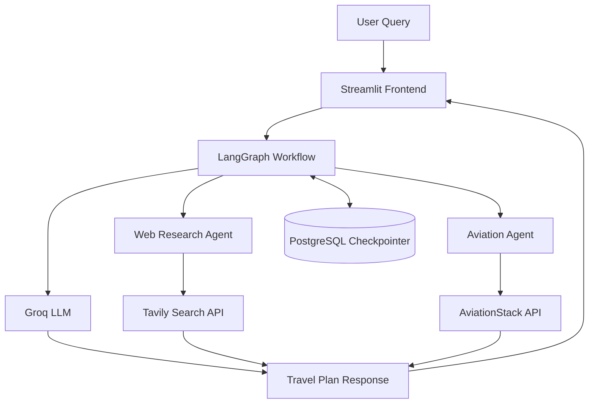

# ✈️ Multi-Agent AI Travel Planner

### Your AI-powered travel companion — research, flights, and smarter trip planning in one place.

An intelligent travel planning application powered by **LangGraph, Groq, and specialized AI agents**. It combines web search, aviation data, and persistent workflow state to help users research destinations and generate personalized travel plans through an interactive Streamlit interface.

<p align="center">
  <a href="https://multi-agent-travel-planner-vipul.streamlit.app/">
    
  </a>
  <a href="https://github.com/Vipul24G/multi-agent-travel-planner">
    
  </a>
</p>

---

## 🌟 Why This Project?

Traditional travel planning often requires switching between multiple websites and tools. This project brings AI-powered research and travel assistance into a single application using a **multi-agent workflow**.

## ✨ Key Features

- 🤖 **Multi-Agent Architecture** — Separate agents for specialized travel-related tasks.
- 🧠 **LLM-Powered Planning** — Uses Groq-hosted language models to understand queries and generate responses.
- 🔎 **Web Research Agent** — Retrieves relevant information using the Tavily Search API.
- ✈️ **Aviation Agent** — Integrates AviationStack for aviation and flight-related data.
- 🛠️ **Tool Integration** — Connects agents with external APIs and tools.
- 🗄️ **Persistent Workflow State** — Uses PostgreSQL and LangGraph's `PostgresSaver` for checkpointing.
- 💻 **Interactive Streamlit UI** — A user-friendly interface for interacting with the travel planner.

## 🏗️ Architecture



*Architecture diagram is a conceptual overview; adjust the nodes and connections to match your actual implementation.*

## 🧰 Tech Stack

| Component | Technology |
|---|---|
| Language | Python |
| Agent Orchestration | LangGraph |
| Language Model | Groq |
| Web Search | Tavily API |
| Aviation Data | AviationStack API |
| Database | PostgreSQL |
| Checkpointing | LangGraph PostgresSaver |
| Frontend | Streamlit |

## 📂 Project Structure

```text
multi-agent-travel-planner/
├── frontend.py
├── main.py
├── requirements.txt
├── tools/
│   ├── tavily_tool.py
│   ├── flight_tool.py
│   └── aviation_tool.py
├── .gitignore
└── README.md
```

*Update the structure above if your actual filenames or folders differ.*

## ⚙️ Getting Started

### 1. Clone the repository

```bash
git clone https://github.com/Vipul24G/multi-agent-travel-planner.git
cd multi-agent-travel-planner
```

### 2. Create a virtual environment

```bash
python -m venv venv
```

Activate it on Windows:

```powershell
.\venv\Scripts\Activate.ps1
```

### 3. Install dependencies

```bash
pip install -r requirements.txt
```

### 4. Configure environment variables

Create a `.env` file in the project root:

```env
GROQ_API_KEY=your_groq_api_key
TAVILY_API_KEY=your_tavily_api_key
AVIATIONSTACK_API_KEY=your_aviationstack_api_key
DATABASE_URL=your_postgresql_connection_url
```

Replace the placeholders with your own credentials. Never commit real API keys or database passwords.

### 5. Run the application

```bash
python -m streamlit run frontend.py
```

## 🔐 Security

- Keep API keys and database credentials in environment variables or your deployment platform's secrets manager.
- Exclude `.env` and `.streamlit/secrets.toml` from Git.
- Never expose database credentials in screenshots, logs, or public repositories.

## 🚀 Future Improvements

- More specialized travel agents.
- Improved itinerary personalization.
- Better error handling and API fallback mechanisms.
- Additional travel information sources.
- More comprehensive automated testing.

## 👨‍💻 Author

**Vipul Gupta**

- GitHub: [@Vipul24G](https://github.com/Vipul24G)

---

<p align="center">
  <i>Built to explore the possibilities of agentic AI in travel planning.</i>
</p>
